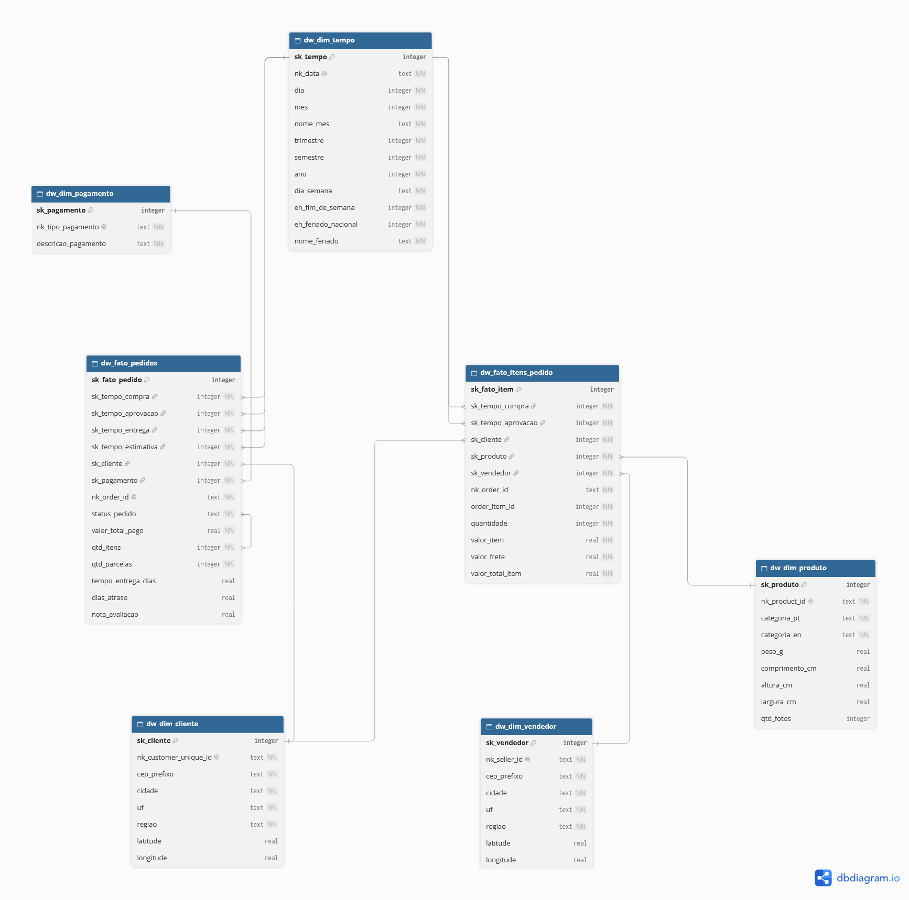

# Data Warehouse - Olist

Pipeline de ETL e modelagem dimensional (esquema estrela) construídos em SQLite e Python a partir do dataset público de e-commerce da Olist.

## Visão geral

Os dados brutos dos CSVs são carregados primeiro em tabelas de staging (`stg_*`) sem alteração de conteúdo, mantendo os prefixos de CEP como texto para não perder zeros à esquerda. Em seguida, um script SQL faz a limpeza, deduplicação e carga nas tabelas do Data Warehouse (`dw_*`).

Algumas decisões tomadas no ETL para lidar com inconsistências da base original:
- Uso de registros sentinela com chave `-1` nas dimensões para evitar chaves estrangeiras nulas (como pedidos cancelados sem data de entrega ou aprovação).
- Deduplicação de `customer_unique_id` na dimensão de clientes mantendo o endereço da compra mais recente.
- Consolidação de pedidos com múltiplos pagamentos somando o valor total pago e selecionando o meio de pagamento de maior valor como principal.
- Preenchimento padrão (`sem_categoria`) para produtos sem categoria e fallback para o nome em português nas categorias que não constam na tabela de tradução (`pc_gamer` e `portateis_cozinha_e_preparadores_de_alimentos`).

## Modelo dimensional



### Tabelas do DW

- **`dw_dim_tempo`**: calendário de `2016-09-01` a `2018-12-31` (`sk_tempo` no formato `YYYYMMDD`), hierarquia de data, dia da semana, fim de semana e feriados nacionais.
- **`dw_dim_cliente`**: clientes únicos (`nk_customer_unique_id`) com prefixo de CEP de 5 dígitos, cidade, UF, macrorregião e coordenadas médias (`latitude`, `longitude`).
- **`dw_dim_produto`**: produtos (`nk_product_id`) com categoria em português/inglês, dimensões físicas e quantidade de fotos.
- **`dw_dim_vendedor`**: lojistas (`nk_seller_id`) com localização, macrorregião e coordenadas médias por prefixo de CEP.
- **`dw_dim_pagamento`**: meios de pagamento (`credit_card`, `boleto`, `voucher`, `debit_card`, `not_defined`) e descrição em português.
- **`dw_fato_pedidos`** (1 linha por pedido): relaciona o pedido às datas de compra, aprovação, entrega e estimativa, cliente e meio de pagamento principal, armazenando `valor_total_pago`, `qtd_itens`, `qtd_parcelas`, `tempo_entrega_dias`, `dias_atraso` e `nota_avaliacao`.
- **`dw_fato_itens_pedido`** (1 linha por item do pedido): relaciona cada item às datas de compra e aprovação, cliente, produto e vendedor, armazenando `quantidade`, `valor_item`, `valor_frete` e `valor_total_item`.

## Organização das pastas

```text
projeto-dw-olist/
├── data/                     # CSVs originais do Kaggle (ignorados no git)
├── ddl/
│   ├── 01_create_staging.sql # Tabelas de staging
│   └── 02_create_dw.sql      # Tabelas do DW e registros sentinela (-1)
├── etl/
│   └── etl_dw.sql            # Queries de transformação e carga
├── queries/
│   ├── 01_validacao.sql      # Checagem de contagem e sentinelas
│   └── 02_kpis.sql           # Consultas de faturamento, entrega, categorias e pagamentos
├── executar_dw.py            # Script que orquestra a criação e carga do banco
├── m_estrela.png             # Diagrama do esquema estrela
└── requirements.txt
```

## Como rodar

1. Instale a dependência do Python:
```bash
pip install -r requirements.txt
```

2. Baixe a base *Brazilian E-Commerce Public Dataset by Olist* no Kaggle e extraia os 9 arquivos `.csv` dentro da pasta `data/`.

3. Execute o script na raiz do repositório:
```bash
python executar_dw.py
```

O script cria o banco `olist_dw.sqlite` na raiz do projeto, importa os CSVs para a staging, roda o ETL para o DW e valida a integridade das chaves estrangeiras ao final.

Para conferir os números carregados e rodar as análises, basta abrir o `olist_dw.sqlite` no seu cliente SQL de preferência e executar os arquivos da pasta `queries/`.